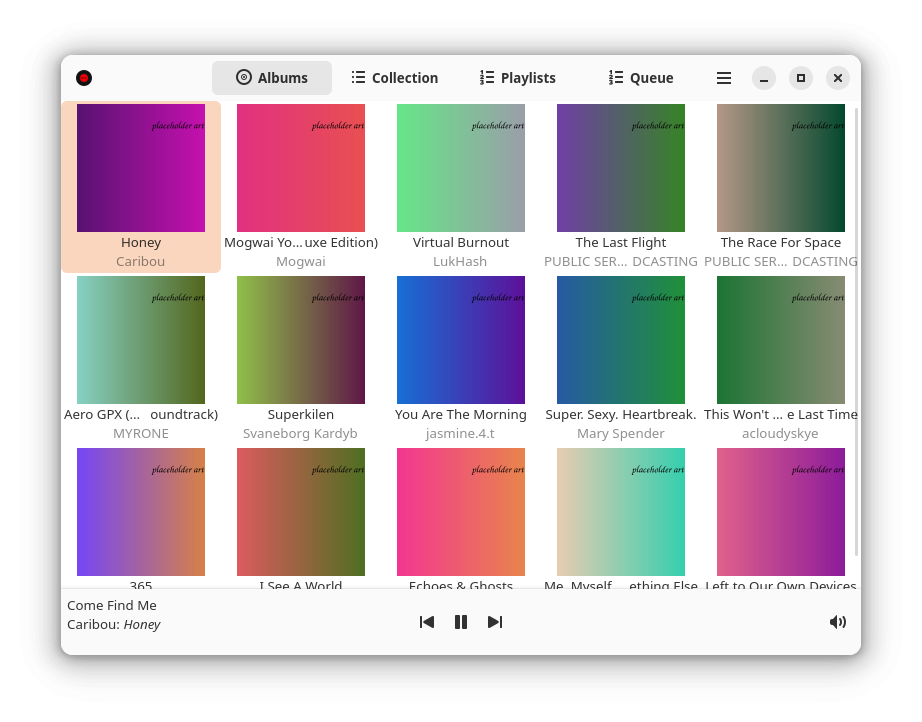

#  NextGroove

GNOME based client for Nextcloud Music created as a holiday programming
project and therefore its functionality is quite limited: check the current capabilities section.

## Current Capabilities

 - Connects to a Nextcloud instance of your choice via normal API tokens (does not use subsonic/ampache endpoints but the [Nextcloud ones](https://github.com/owncloud/music?tab=readme-ov-file#api)
 - Can select music from an album view (most recent first), a full list of songs in the collection, or playlists.
 - Can append to the queue from album and collections view, but not from playlist view.
 - Basic MPRIS support allowing to be controlled via common controls and shortcuts.
 - Does *not* support shuffle play or repeating the queued music.
 - Does *not* support other media like podcasts.
 - Does *not* cache music/album-art/collection details. Therefore this will do many calls on every startup to retrieve album art. This was tested with the server sitting next to the desktop running this client.

